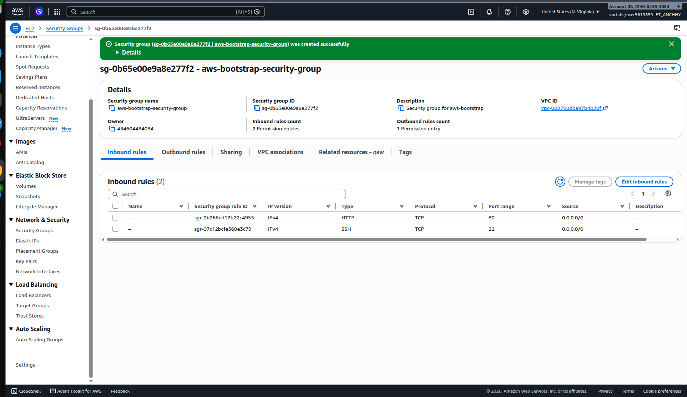
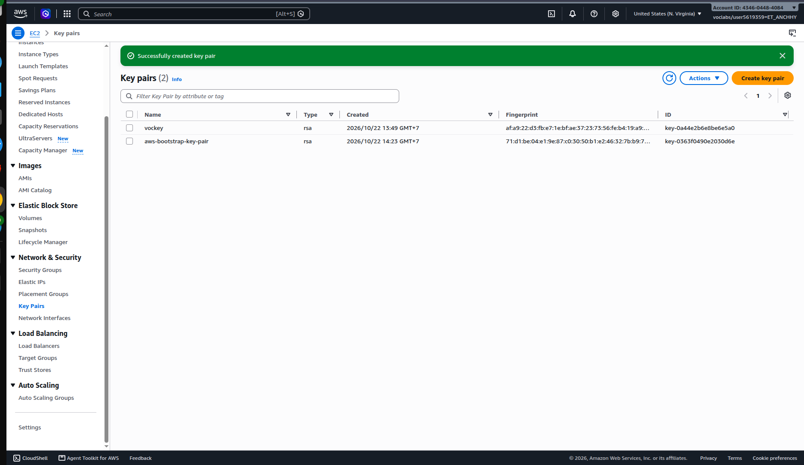
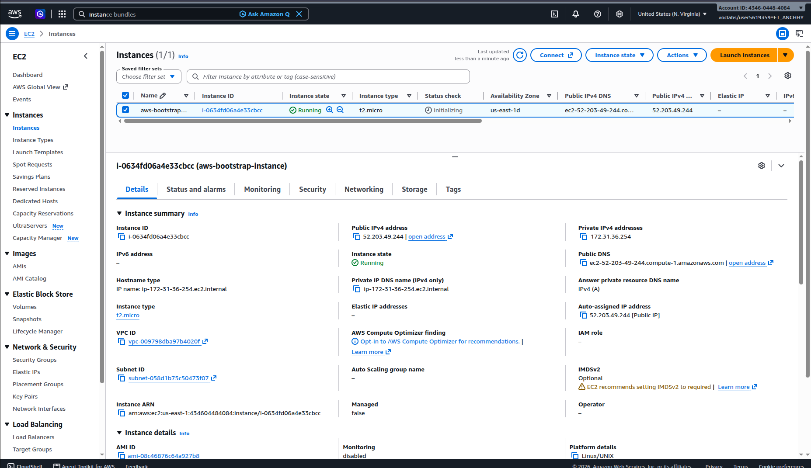
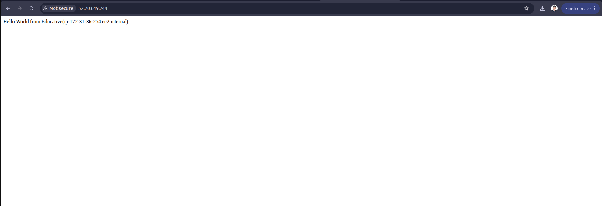
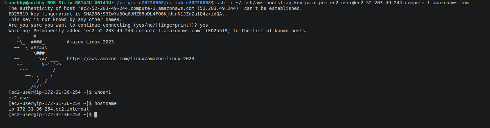
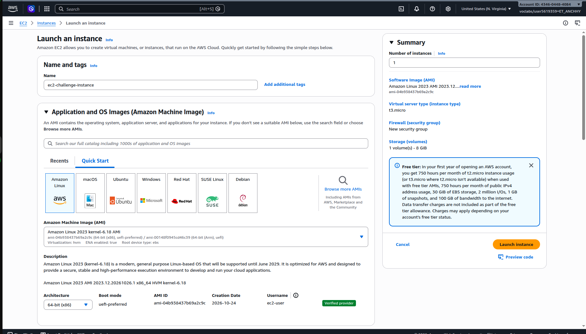
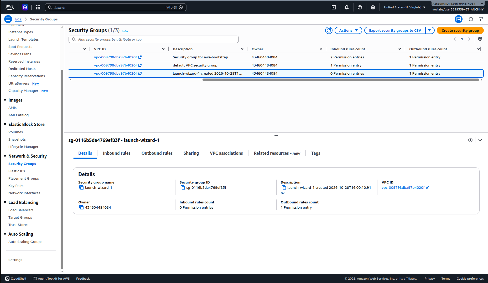
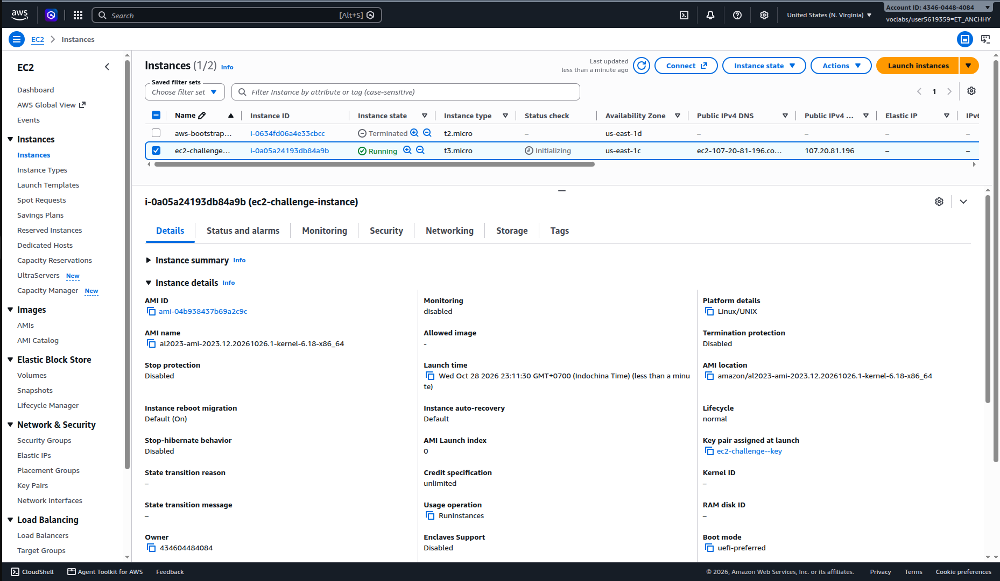

# Cloud Lab 1 Submission — Amazon EC2

Copy this template to `cc-lab-YOUR_ID/lab1/README.md` in your own repository. Follow [the instructions](lab1-instruction.md). Put your screenshots in `lab1/images/` with the file names below.

- **Student name:** ET Anchhy
- **Student ID:** e20220608
- **Learner Lab user name:** ET_ANCHHY
- **Date completed:** 28/10/2026

---

## Part 1.1 — An Amazon EC2 Walkthrough

### Security group



### Key pair



### Instance details



### Browser test



### SSH connection



Did you connect with your own SSH client or with EC2 Instance Connect?

I connected with my own SSH client, from the terminal on my computer, using the private
key from `aws-bootstrap-key-pair`:

```bash
ssh -i ~/.ssh/aws-bootstrap-key-pair.pem ec2-user@ec2-52-203-49-244.compute-1.amazonaws.com
```

`whoami` returned `ec2-user`, and `hostname` returned `ip-172-31-36-254.ec2.internal`, the
same private host name shown on the web page.

---

## Part 1.2 — EC2 Web Solution (Challenge)

### Launch configuration



### Security group



### Running instance



### Commands on the instance


Paste the commands you ran to install the web server and create `index.html`:

```bash

```

### Browser test


---

## Questions

### 1. Your security group has an SSH rule and an HTTP rule. What does each one let you do? What would stop working if you deleted the HTTP rule?

A security group blocks all inbound traffic unless a rule allows it. Both rules in
`aws-bootstrap-security-group` use the source `0.0.0.0/0`, so they accept any IPv4 address.

- **SSH (TCP port 22):** lets me log in to the instance and use a remote terminal. I still
  need the private key to get in.
- **HTTP (TCP port 80):** lets a browser reach the web server and load the page.

If I deleted the HTTP rule, the web page would stop loading. The browser would wait and
then time out, because the security group blocks the request before it reaches the
instance. The instance and the web server would keep running, and SSH would still work.

### 2. In Part 1.1 you never logged in to install the web server. What installed it, and when did it run?

The **user data** script installed it. This script is set under **Advanced details** when
launching the instance. EC2 passes it to cloud-init, which runs it as root one time, during
the instance's first boot. That is why the web server was ready without me logging in.
The page also showed the instance's own host name, `ip-172-31-36-254.ec2.internal`.

### 3. Why does the web page open with `http://` but not with `https://`?

HTTP uses port 80 and HTTPS uses port 443. My security group only allows ports 80 and 22,
so a request to port 443 is blocked. The web server also has no TLS certificate, so it can
only serve plain HTTP. This is why the browser shows *Not secure* next to the address.

For HTTPS to work, I would need an inbound rule for port 443, a TLS certificate, and a web
server configured to use that certificate.

### 4. Part 1.2 asked for a 10 GiB root volume. Where in the launch settings did you set it, and how can you check the size on the running instance?

The size is set in the **Configure storage** section of the launch wizard, by changing the
root volume from the default 8 GiB to 10 GiB. The **Summary** panel then shows
`1 volume(s) - 10 GiB`.

There are two ways to check it on the running instance:

- **In the console:** select the instance and open the **Storage** tab.
- **On the instance:** run `lsblk` to see the size of the disk, or `df -h /` to see the size
  of the root file system.

## Problems and how I solved them (optional)

## AI note (optional)

One suggestion an AI tool gave you and how you checked it.

## Clean up

- [ ] Part 1.1: instance terminated, key pair and security group deleted.
- [ ] Part 1.2: instance terminated, security group (and key pair, if any) deleted.
