# Cloud Lab 2 Submission — Load Balancer and Auto Scaling

Copy this template to `cc-lab-YOUR_ID/lab2/README.md` in your own repository. Follow [the instructions](lab2-instruction.md). Put your screenshots in `lab2/images/` with the file names below.

- **Student name:ET Anchhy**
- **Student ID: e20220608**
- **Learner Lab user name: ET_ANCHHY**
- **Date completed: 5/11/2026**

---

## Security groups

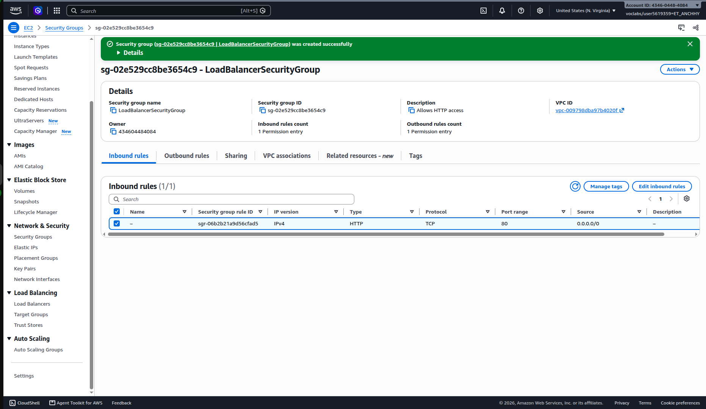

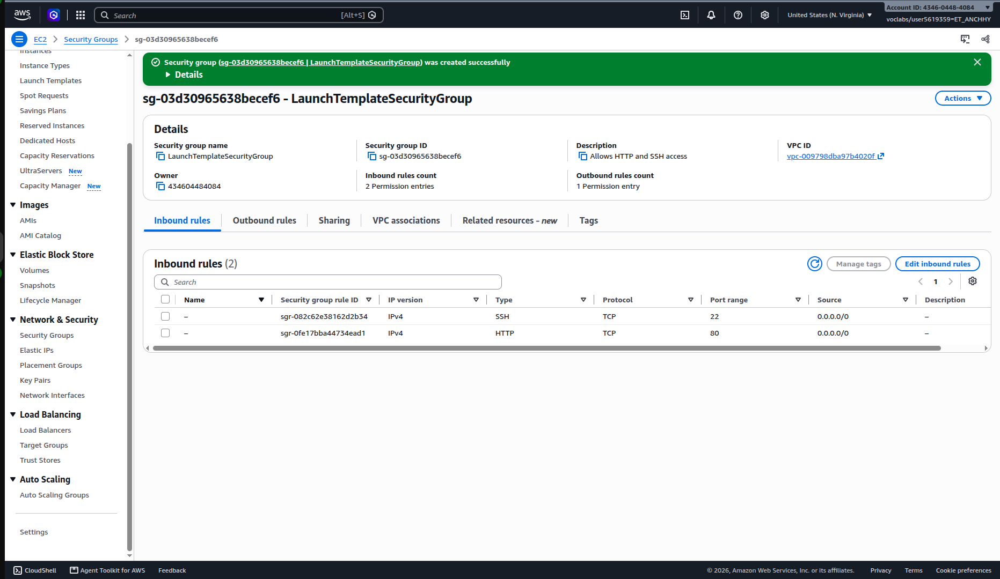

## Target group

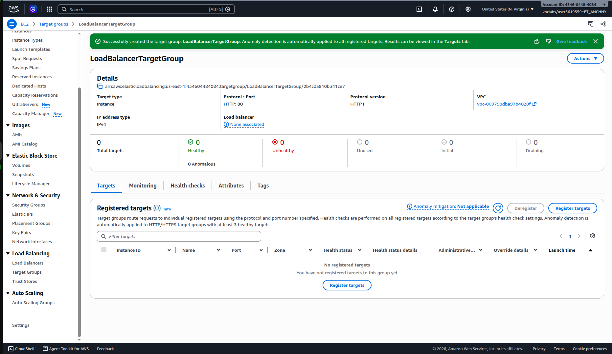

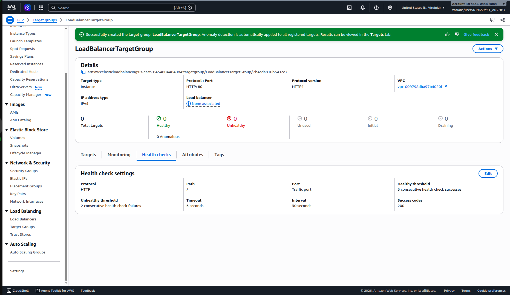

## Application Load Balancer

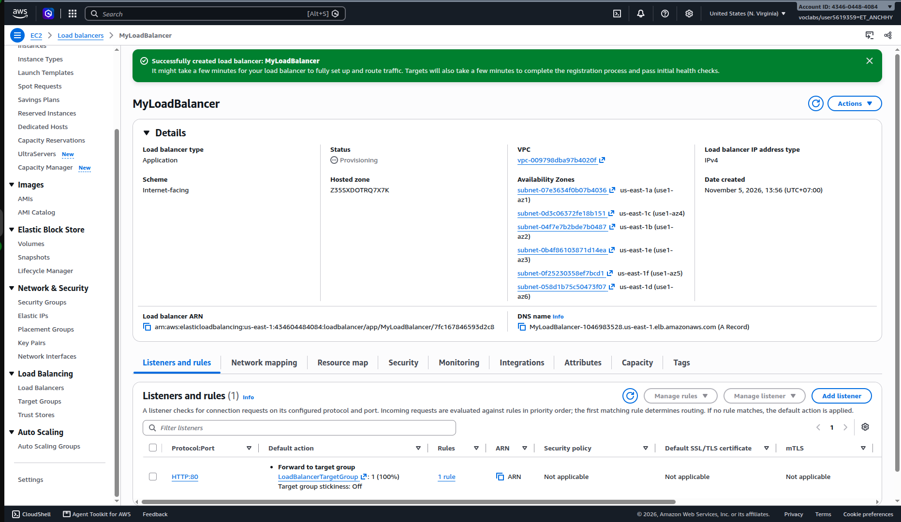

## Launch template

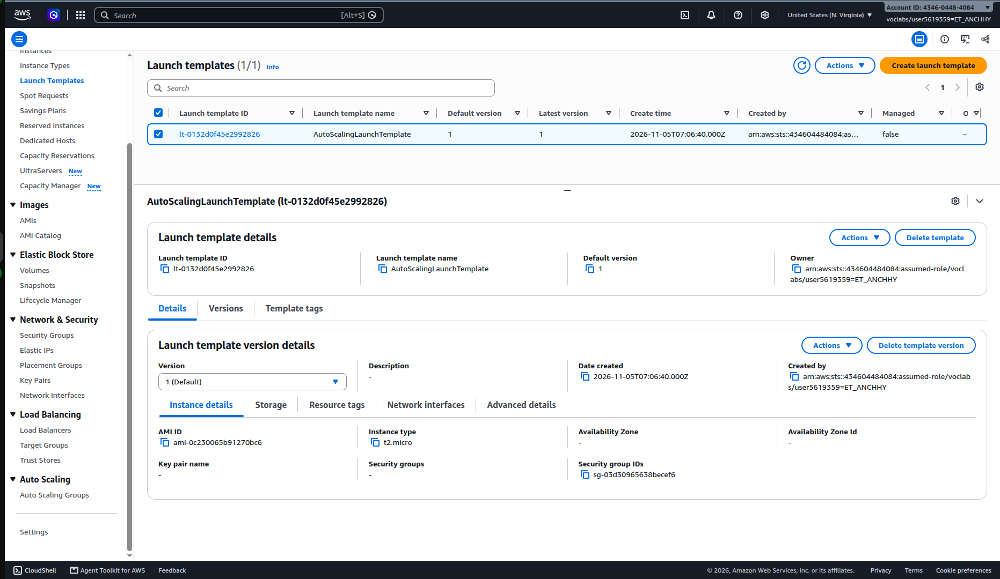

## Auto Scaling group

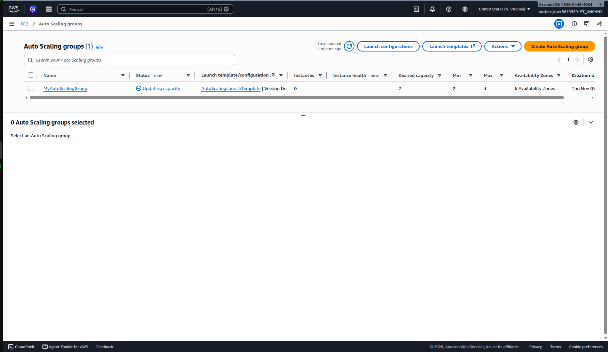

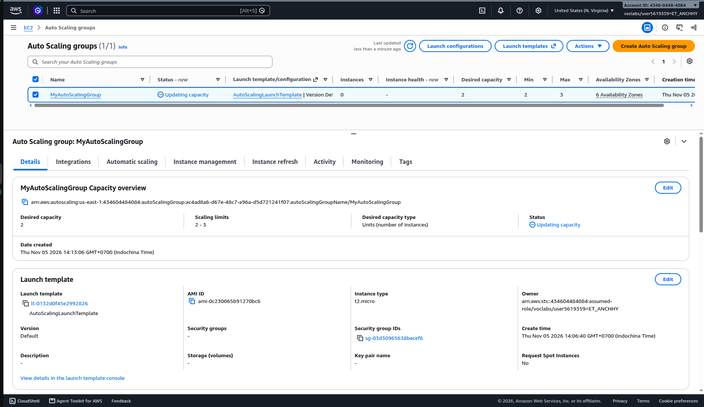

## Load balancing test

## Simulated application failure

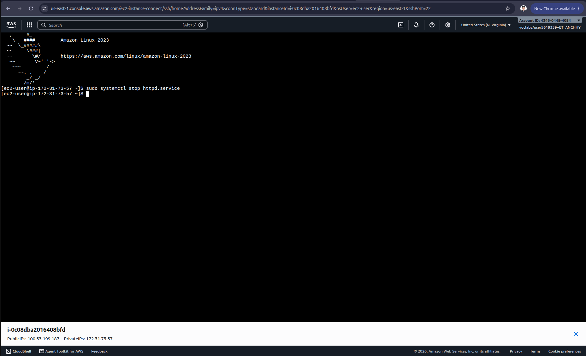

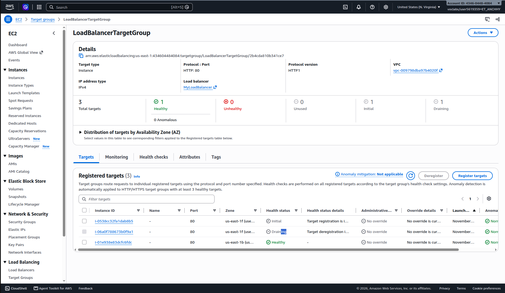

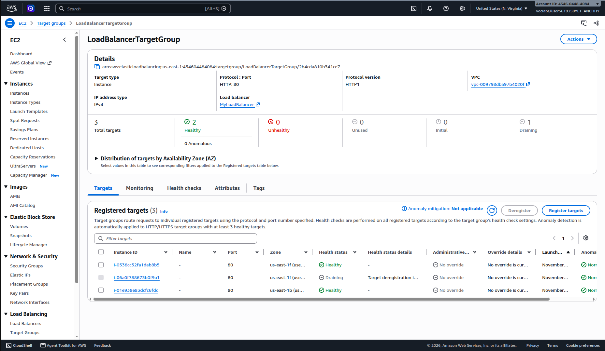

About how many minutes passed between stopping `httpd` and the new instance becoming healthy?

## Questions

### 1. Why does the page show a different host name when you refresh it?

Each instance ran the user data script at launch, which wrote its own host name into
`/var/www/html/index.html`. So each instance serves a different page. The load balancer
sends each new request to one of the healthy targets in `LoadBalancerTargetGroup`. By
default it uses round robin. When I refresh, the request can go to the other instance,
and that instance answers with its own host name.

If the page did not change, the browser was reusing the same open (keep-alive)
connection. A hard refresh (Ctrl+Shift+R) or an incognito window showed the other host.

### 2. Why was the instance unhealthy while it was still running?

The target group's health check sends an HTTP `GET /` to port 80 on each target every
30 seconds and expects status code `200`. After I ran `sudo systemctl stop httpd.service`,
nothing was listening on port 80, so the health check request failed. After 2 failed
checks in a row (the unhealthy threshold), the target group marked it *unhealthy*.

EC2 still showed the instance as *running* because EC2 status checks only test the
hardware, the network and the operating system, not the application. The load balancer's
health check tests the application itself.

### 3. Who replaced the failed instance?

The **Auto Scaling group** replaced it.

- **Load balancer (`MyLoadBalancer`):** the single entry point for clients. Its listener
  (HTTP:80) forwards requests to the target group, and it stops sending traffic to
  unhealthy targets. It does not create or delete instances.
- **Target group (`LoadBalancerTargetGroup`):** holds the registered instances and runs
  the health checks. It reports each target as healthy or unhealthy and drains the
  unhealthy ones.
- **Auto Scaling group (`MyAutoScalingGroup`):** keeps the desired number of instances.
  Because I turned on **Elastic Load Balancing health checks**, it treated the instance
  the target group marked unhealthy as unhealthy too. It terminated that instance and
  launched a new one from `AutoScalingLaunchTemplate`. The new instance was registered in
  the target group automatically and became healthy.

### 4. How many instances run normally, and when could there be 3?

Normally **2** run, because the ASG keeps the desired capacity. The minimum of 2 means
it never goes below 2, and the maximum of 3 is the upper limit.

There could be 3 if the desired capacity is raised to 3. That happens if a scaling policy
adds an instance (for example, a target tracking policy when average CPU goes above a
target), if a scheduled action changes it, or if someone sets it to 3 by hand. In this
lab I did not add any scaling policy, so it stayed at 2. It can never go above 3.

### 5. How can the instances accept HTTP only from the load balancer?

Edit the HTTP inbound rule of `LaunchTemplateSecurityGroup`. Change the source from
`0.0.0.0/0` to **Custom**, then select the load balancer's security group,
`LoadBalancerSecurityGroup` (`sg-02e529cc8be3654c9`). Only traffic coming from network
interfaces that use that security group (the load balancer's) is then allowed on port 80.
Opening an instance's public IP directly in a browser would no longer work, but the
load balancer's DNS name would still work.

In the same way, SSH could be limited to My IP or to the EC2 Instance Connect prefix list
(`com.amazonaws.us-east-1.ec2-instance-connect`) instead of `0.0.0.0/0`.
